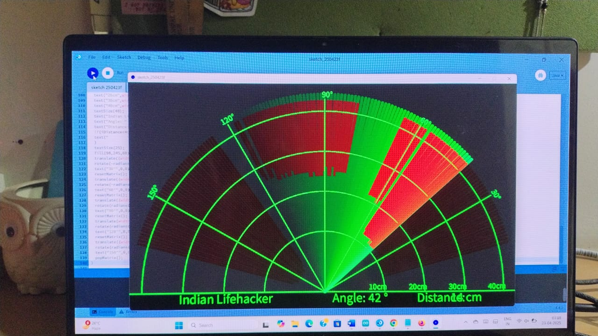
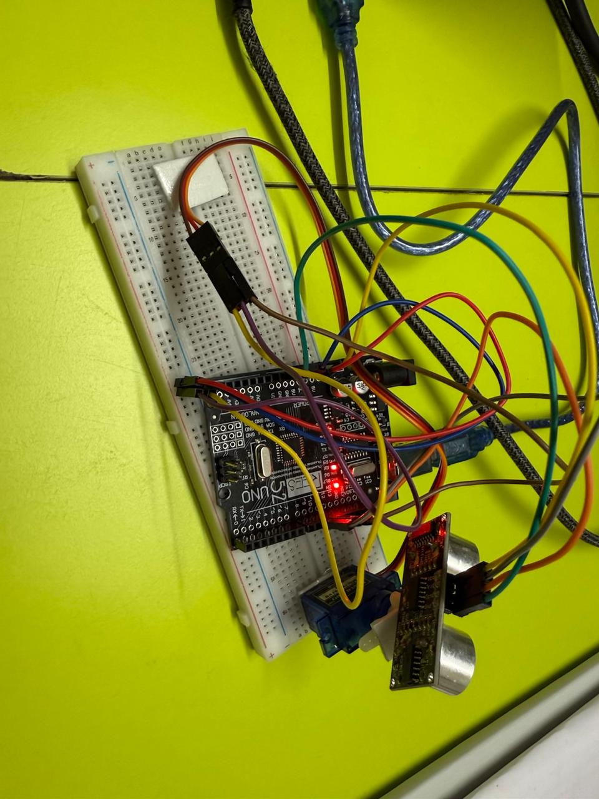

# Smart Radar System for Real-Time Object Mapping

A low-cost radar system that detects nearby objects and maps their position in real time. An **HC-SR04 ultrasonic sensor** mounted on an **SG90 servo motor** sweeps a 180° arc, an **Arduino Uno** measures the distance at each angle, and a **Processing** sketch on the computer draws a live radar display showing where each object is.

> 📜 **Published Patent:** *A Device for Smart Radar-Based Object Detection Using an Arduino Uno Microcontroller*,
> Indian Patent Application No. **202611075957 A** (2026), co-invented with **Anushka Jamindar** and **Dr. Rohit Mittal**.



---

## Table of Contents
- [Overview](#overview)
- [How It Works](#how-it-works)
- [Hardware](#hardware)
- [Circuit Connections](#circuit-connections)
- [Software](#software)
- [Getting Started](#getting-started)
- [Results](#results)
- [Applications](#applications)
- [What Makes It Different](#what-makes-it-different)
- [Limitations & Future Scope](#limitations--future-scope)
- [Repository Structure](#repository-structure)
- [Authors](#authors)

---

## Overview

Traditional radar systems are bulky, expensive and need specialised hardware. This project gives you the core of what a radar does (scan, detect, range, map) using parts that cost very little and fit on a breadboard:

- **180° wide-area scanning** from a single sensor on a servo, with no need for several sensors
- **Real-time visualisation** of each object's angle and distance on a radar-style interface
- **Low power and portable**, so it can run from a basic battery
- **Ultrasonic sensing**, which is simpler and safer to work with than high-frequency radio waves

## How It Works

```
┌──────────────┐   angle,distance.   ┌──────────────────┐
│ Arduino Uno  │ ──── USB serial ───▶│  Processing GUI  │
│              │     (9600 baud)     │  radar display   │
│  ┌────────┐  │                     └──────────────────┘
│  │ Servo  │◀─┤ pin 12  sweeps 15°↔165°
│  └───┬────┘  │
│  ┌───▼────┐  │
│  │HC-SR04 │◀─┤ trig 10 / echo 11
│  └────────┘  │
└──────────────┘
```

1. The servo steps one degree at a time between 15° and 165°, then sweeps back.
2. At every step the Arduino fires a 10 µs trigger pulse and times the echo:
   `distance (cm) = duration (µs) × 0.034 / 2`
3. It sends the reading over serial as `angle,distance.` (the `.` marks the end of each reading).
4. The Processing sketch reads up to each `.`, splits on `,`, and draws:
   - a **green sweep line** at the current angle
   - a **red region** wherever an object is detected within 40 cm
   - the live **angle** and **distance** values, with **In Range / Out of Range** status

## Hardware



| Component | Qty | Purpose |
|---|---|---|
| Arduino Uno R3 | 1 | Microcontroller: drives the servo, reads the sensor, sends data over serial |
| HC-SR04 ultrasonic sensor | 1 | Measures the distance to objects |
| SG90 micro servo motor | 1 | Rotates the sensor across a 180° arc |
| Breadboard (400-point) | 1 | Prototyping base |
| Jumper wires (male-to-male) | ~10 | Connections |
| USB cable | 1 | Power, code upload and serial data to the PC |

The ultrasonic sensor is fixed on top of the servo horn with double-sided tape so it stays steady while rotating.

## Circuit Connections

| Module | Pin | Arduino Uno |
|---|---|---|
| HC-SR04 | VCC | 5V |
| HC-SR04 | GND | GND |
| HC-SR04 | Trig | D10 |
| HC-SR04 | Echo | D11 |
| SG90 Servo | Red (VCC) | 5V |
| SG90 Servo | Brown (GND) | GND |
| SG90 Servo | Orange (Signal) | D12 |

## Software

| Tool | Version used | Role |
|---|---|---|
| [Arduino IDE](https://www.arduino.cc/en/software) | 2.x | Write and upload the sensor and servo control code |
| [Processing](https://processing.org/download) | 4.4.2 | Run the real-time radar visualisation |

Libraries: `Servo.h` (bundled with the Arduino IDE) and `processing.serial` (bundled with Processing).

## Getting Started

### 1. Upload the Arduino code
1. Open [`Arduino_Code/smart_radar/smart_radar.ino`](Arduino_Code/smart_radar/smart_radar.ino) in the Arduino IDE.
2. Select **Tools → Board → Arduino Uno** and the correct **Port**.
3. Click **Upload**. The servo should start sweeping back and forth.
4. Note the COM port, then **close the Serial Monitor** so Processing can use the port.

### 2. Run the radar display
1. Open [`Processing_Code/radar_display/radar_display.pde`](Processing_Code/radar_display/radar_display.pde) in Processing.
2. Change the serial port to match your Arduino:
   ```java
   myPort = new Serial(this, "COM5", 9600);   // e.g. "COM3" on Windows, "/dev/ttyUSB0" on Linux
   ```
3. If needed, change `size(1200, 700)` to suit your screen.
4. Click **Run**. Place objects in front of the sensor and watch them appear as red regions on the radar.

## Results

The system was tested with a range of objects, indoors and outdoors:

| # | Object Type | Distance Detected (cm) | Angle of Detection (°) | Status |
|---|---|---|---|---|
| 1 | Cardboard box | 40 | 45 | ✅ Detected |
| 2 | Plastic bottle | 25 | 135 | ✅ Detected |
| 3 | Wall (static object) | 100 | 0 | ✅ Detected |
| 4 | Human hand | 20 | 60 | ✅ Detected |
| 5 | Moving object | 20–60 (varies) | 30–150 (varies) | ✅ Tracked |
| 6 | No object | > 200 | All | No object detected |

The system was stable, responsive and accurate in practice, and handled obstacle detection and mapping well.

## Applications

- **Robotics:** obstacle detection and avoidance for autonomous robots
- **Surveillance:** spotting movement and monitoring an area in real time
- **Self-driving vehicles:** short-range awareness of nearby objects
- **Navigation:** a clear picture of the surroundings in unfamiliar indoor or outdoor spaces
- **Search and rescue:** finding obstacles or people in disaster zones
- **Drones:** light and compact enough to carry without much extra load
- **Education:** a hands-on way to learn embedded systems, sensors and real-time data

## What Makes It Different

Most existing radar-based detection systems rely on RF radar, LiDAR or transponder data, which need expensive hardware and complex signal processing (for example WO2024255987A1, US11733386B2 and US10534070B2). This device gets the core radar functions of scanning, ranging and visual mapping from an Arduino Uno, one ultrasonic sensor and one servo:

- **Cost:** built entirely from widely available, budget-friendly parts
- **Coverage:** 180° scanning without multiple sensors or heavy motors
- **Portability:** compact, light and low-power
- **Usability:** an easy-to-read visual map of each object's angle and distance

## Limitations & Future Scope

**Limitations**
- The display is set to a 40 cm range, and the HC-SR04 is only reliable up to about 4 m
- Ultrasonic readings can be affected by soft, angled or sound-absorbing surfaces
- Data is sent over a USB cable

**Future scope**
- Wireless data link (Bluetooth / Wi-Fi with ESP32)
- AI-based object classification and tracking
- Full 360° scanning and longer-range sensors
- Logging and mapping of scans over time

## Repository Structure

```
.
├── Arduino_Code/
│   └── smart_radar/
│       └── smart_radar.ino        # Servo sweep + ultrasonic ranging + serial output
├── Processing_Code/
│   └── radar_display/
│       └── radar_display.pde      # Real-time radar visualisation
├── images/
│   ├── hardware_setup.jpeg
│   └── radar_output.jpeg
└── README.md
```

## Authors

- **Saanvi Chauhan**
- **Anushka Jamindar**
- **Dr. Rohit Mittal** (Guide)

Developed as a Project Based Learning (PBL) project.

## Acknowledgements

The Arduino and Processing code is adapted from the widely shared open-source Arduino radar tutorial (the on-screen "Indian Lifehacker" label comes from it).
